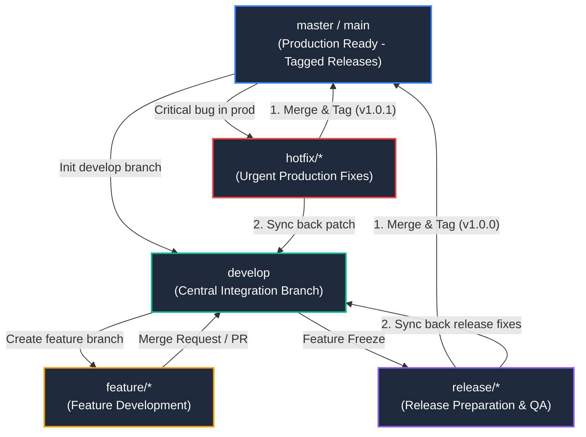
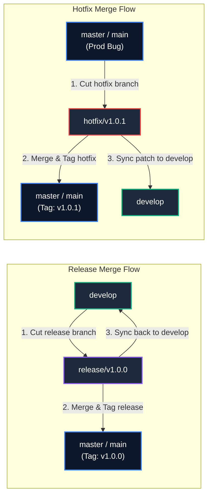
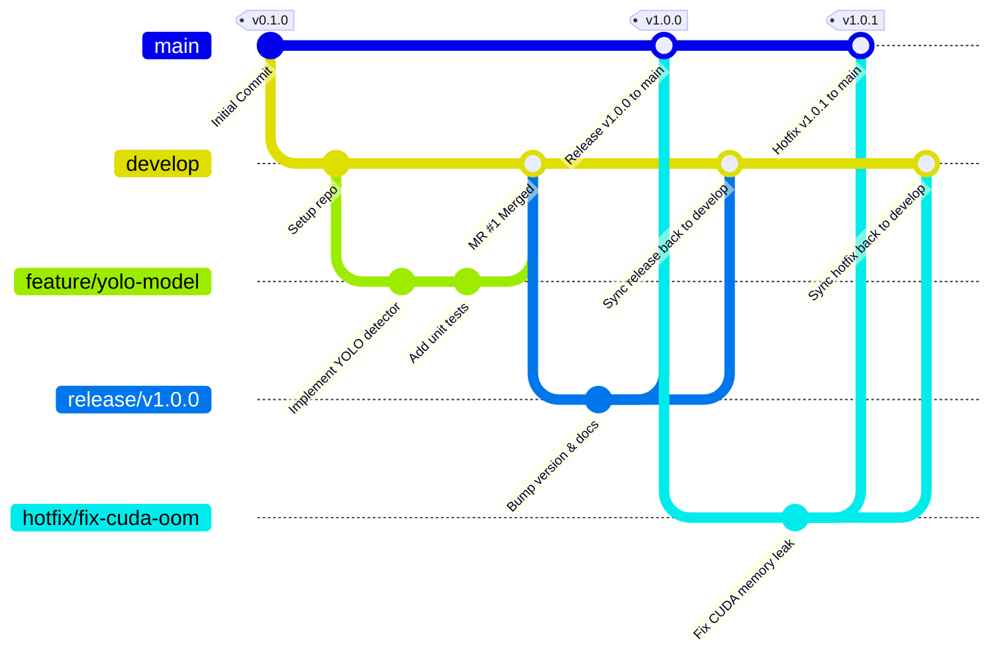

# Gitflow Workflow & Collaboration Standards

This document establishes the official **Gitflow Workflow** for our AI Research Team, adapted from [Vincent Driessen's Gitflow Model](https://nvie.com/posts/a-successful-git-branching-model/) and [Viblo Gitflow Guide](https://viblo.asia/p/co-ban-ve-gitflow-workflow-4dbZNn6yZYM).

Gitflow provides a strict branching architecture designed for scheduled release cycles, collaborative feature development, and production hotfixes.

---

## Table of Contents
- [1. Branch Architecture & Roles](#1-branch-architecture--roles)
  - [Main Branches](#main-branches)
  - [Supporting Branches](#supporting-branches)
- [2. Branch Breakdown & Lifecycle](#2-branch-breakdown--lifecycle)
  - [Master / Main Branch](#master--main-branch)
  - [Develop Branch](#develop-branch)
  - [Feature Branches (`feature/*`)](#feature-branches-feature)
  - [Release Branches (`release/*`)](#release-branches-release)
  - [Hotfix Branches (`hotfix/*`)](#hotfix-branches-hotfix)
- [3. Step-by-Step Development Flow](#3-step-by-step-development-flow)
  - [Developing a New Feature](#developing-a-new-feature)
  - [Preparing a Release](#preparing-a-release)
  - [Applying a Hotfix](#applying-a-hotfix)
- [4. Merge Request (MR / PR) Guidelines](#4-merge-request-mr--pr-guidelines)
- [5. Resolving Code Conflicts](#5-resolving-code-conflicts)
- [6. Conventional Commit Messages](#6-conventional-commit-messages)
- [7. Handling Large Files & Model Weights](#7-handling-large-files--model-weights)
- [8. Reference Links](#8-reference-links)

---

### Gitflow Branch Relationship Diagram



### Release & Hotfix Merge Flowchart



### Gitflow Timeline & Commit Diagram




### Main Branches
- **`master` / `main`**: Stores the official, production-ready release history. Every commit on `master` represents a stable release version tagged with a version number (e.g. `v1.0.0`, `v1.1.0`). Direct pushes are strictly forbidden.
- **`develop`**: Serves as the integration branch for all completed features. Stores the full latest development history for the next upcoming release cycle.

### Supporting Branches
- **`feature/*`**: Created off `develop`. Used to develop individual features or scripts. Merges back into `develop`.
- **`release/*`**: Created off `develop` when features for a release cycle are frozen. Used for final QA testing, documentation updates, and bug fixes. Merges into both `master` (with tag) and `develop`.
- **`hotfix/*`**: Created off `master` to immediately fix critical production bugs. Merges into both `master` (with tag) and `develop`.

---

## 2. Branch Breakdown & Lifecycle

### Master / Main Branch
- **Base Branch:** Initial repository commit.
- **Merge Destination:** From `release/*` or `hotfix/*` branches only.
- **Tagging:** Every merge into `master` MUST be tagged with a semantic version number (e.g., `git tag -a v1.0.0 -m "Release v1.0.0"`).

### Develop Branch
- **Base Branch:** `master`.
- **Merge Destination:** From `feature/*`, `release/*`, or `hotfix/*`.
- **Role:** Central hub for ongoing team development.

### Feature Branches (`feature/*`)
- **Base Branch:** `develop`.
- **Branch Naming:** `feature/<feature-name>` (e.g., `feature/sam2-pipeline`, `feature/vllm-inference`).
- **Merge Destination:** Merges back into `develop` via **Merge Request / Pull Request (MR/PR)** after code review.
- **Deletion:** Delete branch after successful merge.

### Release Branches (`release/*`)
- **Base Branch:** `develop`.
- **Branch Naming:** `release/<version-number>` (e.g., `release/v1.1.0`).
- **Role:** Prepare candidate build for user acceptance testing / QA. Only bug fixes and documentation polish are allowed; no new features.
- **Merge Destination:** Merges into `master` (tagged) AND back into `develop`.

### Hotfix Branches (`hotfix/*`)
- **Base Branch:** `master`.
- **Branch Naming:** `hotfix/<patch-description>` (e.g., `hotfix/fix-cuda-oom-eval`).
- **Role:** Rapid resolution of critical production bugs without waiting for the next feature release.
- **Merge Destination:** Merges into `master` (tagged with patch version, e.g. `v1.0.1`) AND back into `develop`.

---

## 3. Step-by-Step Development Flow

### Developing a New Feature

1. **Pull latest `develop` branch:**
   ```bash
   git checkout develop
   git pull origin develop
   ```

2. **Create a new feature branch:**
   ```bash
   git checkout -b feature/add-yolo-detector
   ```

3. **Commit work using Conventional Commits:**
   ```bash
   git add src/models/yolo_detector.py
   git commit -m "feat(cv): implement YOLO v8 detector module"
   ```

4. **Keep feature branch up-to-date with `develop`:**
   ```bash
   git fetch origin
   git rebase origin/develop
   ```

5. **Push feature branch to remote:**
   ```bash
   git push -u origin feature/add-yolo-detector
   ```

6. **Open a Merge Request / Pull Request to `develop`** for team lead code review.

---

### Preparing a Release

1. **Create release branch from `develop` when feature-complete:**
   ```bash
   git checkout develop
   git pull origin develop
   git checkout -b release/v1.1.0
   ```

2. **Perform final bug fixes, version bumps, and documentation polish on `release/v1.1.0`.**

3. **Merge release into `master` & Tag:**
   ```bash
   git checkout master
   git merge --no-ff release/v1.1.0
   git tag -a v1.1.0 -m "Release Version 1.1.0"
   git push origin master --tags
   ```

4. **Merge release back into `develop` to keep it synchronized:**
   ```bash
   git checkout develop
   git merge --no-ff release/v1.1.0
   git push origin develop
   git branch -d release/v1.1.0
   ```

---

### Applying a Hotfix

1. **Create hotfix branch from `master`:**
   ```bash
   git checkout master
   git pull origin master
   git checkout -b hotfix/v1.0.1-fix-driver-check
   ```

2. **Fix the bug and commit:**
   ```bash
   git commit -m "fix(driver): correct CUDA driver version parsing logic"
   ```

3. **Merge hotfix into `master` and tag:**
   ```bash
   git checkout master
   git merge --no-ff hotfix/v1.0.1-fix-driver-check
   git tag -a v1.0.1 -m "Hotfix v1.0.1"
   git push origin master --tags
   ```

4. **Merge hotfix back into `develop`:**
   ```bash
   git checkout develop
   git merge --no-ff hotfix/v1.0.1-fix-driver-check
   git push origin develop
   git branch -d hotfix/v1.0.1-fix-driver-check
   ```

---

## 4. Merge Request (MR / PR) Guidelines

> [!IMPORTANT]
> **Direct pushes to `develop`, `release/*`, or `master` are strictly prohibited! All code changes must go through Merge Requests / Pull Requests.**

- **Code Review:** Every MR must be reviewed and approved by at least one team member or Tech Lead before merging.
- **Traceability:** MRs serve as audit logs for code changes, architectural decisions, and review discussion threads.
- **CI/CD Automation:** Ensure automated tests and linter checks pass before merging.

---

## 5. Resolving Code Conflicts

Merge conflicts are natural in multi-developer environments. Follow these rules to minimize and resolve conflicts cleanly:

1. **Modular Code Structure:** Keep components decoupled into separate files; avoid massive monolithic script files.
2. **Rebase Frequently:** Regularly rebase your feature branch against `develop`:
   ```bash
   git checkout feature/my-feature
   git fetch origin
   git rebase origin/develop
   ```
3. **Resolve Conflicts Locally:** Fix conflicts locally in your editor, run tests to verify correctness, then push the rebased branch before creating/updating the MR.

---

## 6. Conventional Commit Messages (v1.0.0 Specification)

All Git commits MUST strictly adhere to the [Conventional Commits v1.0.0 specification](https://www.conventionalcommits.org/en/v1.0.0/).

### Structure
```text
<type>[optional scope]: <description>

[optional body]

[optional footer(s)]
```

### Allowed Commit Types
- `feat`: A new feature (corresponds to `MINOR` in Semantic Versioning)
- `fix`: A bug fix (corresponds to `PATCH` in Semantic Versioning)
- `docs`: Documentation only changes
- `style`: Code style changes (white-space, formatting, missing semi-colons, etc.) that do not affect code logic
- `refactor`: Code changes that neither fix a bug nor add a feature
- `perf`: Code changes that improve performance
- `test`: Adding missing tests or correcting existing tests
- `build`: Changes that affect the build system or external dependencies (e.g., `poetry`, `pip`, `npm`)
- `ci`: Changes to CI configuration files and scripts (e.g., GitHub Actions)
- `chore`: Other changes that do not modify `src` or `test` files
- `revert`: Reverts a previous commit

### Rules & Conventions
1. **Imperative Mood:** Use imperative present tense in description (e.g., `add feature`, `fix bug`, `change configuration`).
2. **Capitalization & Punctuation:** Do **not** capitalize the first letter of description (unless proper noun or symbol), and do **not** end description with a period `.`.
3. **Optional Scope:** Scope can be specified in parentheses after the type to describe module/component affected (e.g., `feat(parser): add geojson support`).
4. **Breaking Changes:** Indicate breaking changes with `!` right before colon (e.g., `feat(api)!: restructure endpoint response`) or by adding a `BREAKING CHANGE: <explanation>` token in footer.
5. **Body:** Separate body from subject line with a blank line.
6. **Footers:** Follow standard key-value conventions (e.g., `Fixes #123`, `Co-authored-by: ...`).

### Examples:
```bash
# Feature commit
git commit -m "feat(models): implement SAM 2 segmentation inference pipeline"

# Bug fix commit
git commit -m "fix(cuda): resolve OOM crash during evaluation batching"

# Documentation commit
git commit -m "docs(wiki): add docker install guide with nvidia-container-toolkit"

# Breaking change commit
git commit -m "feat(api)!: change prediction response JSON schema"
```


---

## 7. Handling Large Files & Model Weights

> [!CAUTION]
> **NEVER commit model weights (`.pt`, `.bin`, `.safetensors`, `.onnx`) or raw dataset archives directly into Git repositories!**

- Keep weights and dataset files in `.gitignore`.
- Store weights on HuggingFace Hub, internal MinIO/S3 buckets, or DVC (Data Version Control).

---

## 8. Reference Links

- [Viblo Article: Cơ bản về Gitflow Workflow](https://viblo.asia/p/co-ban-ve-gitflow-workflow-4dbZNn6yZYM)
- [Vincent Driessen Original Gitflow Post (nvie.com)](https://nvie.com/posts/a-successful-git-branching-model/)
- [Atlassian Gitflow Workflow Tutorial](https://www.atlassian.com/git/tutorials/comparing-workflows/gitflow-workflow)
