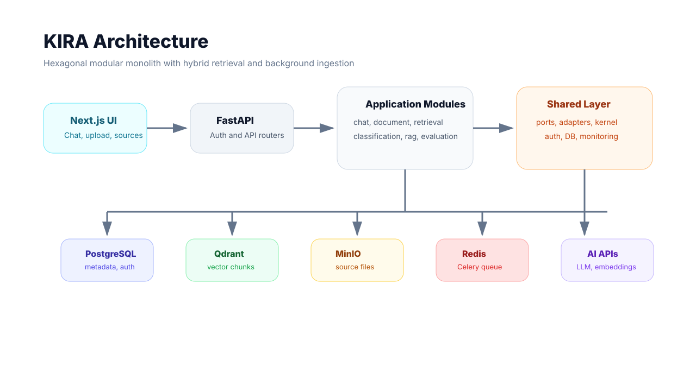

# KIRA: Knowledge-based Intelligent Retrieval Assistant

Private document Q&A with hybrid retrieval and citation-aware streaming chat, built for Vietnamese documents.

[Vuong Ngoc Hau](https://github.com/vuongngochau2004)


## Features

- Upload PDF/DOCX/PPTX/TXT; documents are processed in the background (extract, chunk, embed, index).
- Hybrid retrieval: dense vectors (Qdrant) + BM25, fused with RRF and optional LLM reranking.
- Streaming chat (SSE) with citations that link back to the source chunks.
- Multi-user: JWT authentication, per-user documents, conversations and retrieval.
- Built-in RAG evaluation with DeepEval.

## Pipeline



Upload flow: `Upload -> MinIO -> Celery worker -> Extract / Clean / Chunk -> Embed -> Qdrant + PostgreSQL`

Chat flow: `Query -> Intent routing -> Dense + BM25 -> RRF -> (Rerank) -> LLM -> Answer + citations`

See [System Architecture](docs/system-architecture.md) for the module layout and design rules.

## Installation

Requirements: Python 3.12+, Node.js 20+, Docker, an LLM API key, and an embedding API.

- ### Infrastructure
```bash
git clone https://github.com/vuongngochau2004/kira.git
cd kira
docker compose up -d        # PostgreSQL, Qdrant, MinIO, Redis, Neo4j (legal graph)
```

- ### Environment
```bash
cp .env.example .env
```
Set at least `JWT_SECRET_KEY`, `GLM_API_KEY` (or another `LLM_PROVIDER`), and `EMBEDDING_BASE_URL`. The embedding dimension (`EMBEDDING_DIM`, default `1024`) must match Qdrant.

- ### Backend
```bash
python -m venv .venv && source .venv/bin/activate
pip install -e ".[dev]"
```

- ### Frontend
```bash
cd frontend
npm install --legacy-peer-deps
```

## Usage

Run each service in its own terminal, from the root of the repo.

- ### Backend
```bash
python -m src.server.main
```
API at http://localhost:8006, interactive docs at http://localhost:8006/docs.

- ### Document worker
```bash
celery -A src.worker.celery_app.celery_app worker --loglevel=info --concurrency=2
```
Required for uploads to be processed.

- ### Frontend
```bash
cd frontend
npm run dev
```
Open http://localhost:3001, register an account, upload a document, then ask questions.

`make help` lists shortcuts such as `make dev-backend`, `make dev-worker` and `make dev-frontend`.

- ### Interface

| Chat with citations | Document upload |
|:---:|:---:|
|  |  |

## Evaluation

```bash
make eval-rag USER_ID=<uuid> DATASET=docs/examples/evaluation/golden_sample.json
```
Reports are saved to `reports/evaluation/`.

## Documentation

- [System Architecture](docs/system-architecture.md)
- [Deployment Guide](docs/deployment-guide.md)
- [Document Processing Pipeline](docs/high-accuracy-document-processing-pipeline.md)
- [Project Overview](docs/project-overview.md)
- [Code Standards](docs/code-standards.md)

## License

To be added.
