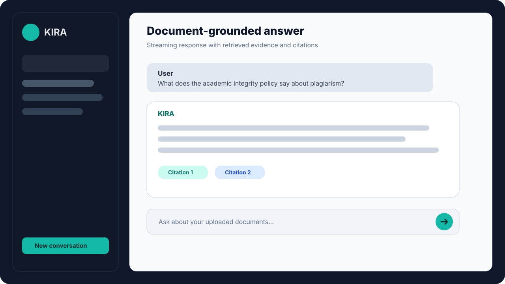
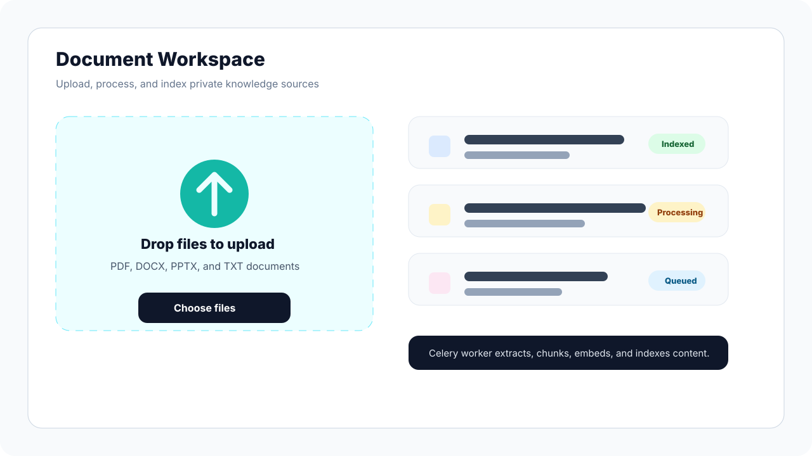
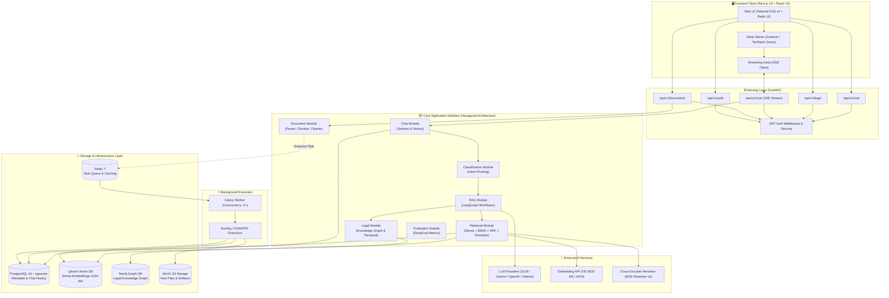
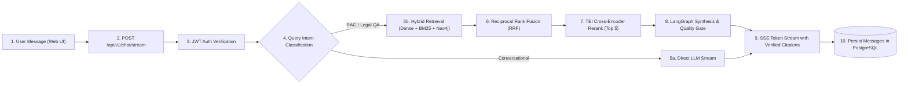

<div align="center">

# 🧠 KIRA: Knowledge-based Intelligent Retrieval Assistant

**Production-grade, Vietnamese-first RAG platform featuring hybrid search, knowledge graph reasoning, citation-grounded streaming chat, and asynchronous document ingestion.**

[](https://www.python.org/)
[](https://fastapi.tiangolo.com/)
[](https://nextjs.org/)
[](https://react.dev/)
[](https://www.typescriptlang.org/)
[](https://www.docker.com/)
[](https://qdrant.tech/)
[-4169E1?style=flat-square&logo=postgresql&logoColor=white)](https://www.postgresql.org/)
[](https://neo4j.com/)
[](https://github.com/vuongngochau2004/kira/pulls)
[](LICENSE)

[Architecture](docs/system-architecture.md) • [Deployment Guide](docs/deployment-guide.md) • [Document Pipeline](docs/high-accuracy-document-processing-pipeline.md) • [Code Standards](docs/code-standards.md) • [Evaluation](docs/examples/evaluation)

</div>

---

## 📸 Preview

<div align="center">

| 💬 Citation-Aware Streaming Chat | 📂 Asynchronous Document Processing |
| :---: | :---: |
|  |  |

</div>

> [!NOTE]
> KIRA provides interactive citation popovers that link generated answers directly back to extracted source chunks with confidence scoring and page verification.

---

## 🚀 Key Features

- 🇻🇳 **Vietnamese-First NLP & Tokenization**: Integrated PyVi syllable/word segmentation, Vietnamese BM25 sparse indexing, and tailored embedding support for accented linguistic nuances.
- ⚡ **Advanced Hybrid Retrieval**: Dense vector similarity search (Qdrant) combined with BM25 keyword matching via **Reciprocal Rank Fusion (RRF)** and optional Cross-Encoder reranking (TEI BGE-Reranker-v2-m3).
- 🕸️ **Vietnamese Legal Knowledge Graph**: Integrated Neo4j graph database enabling statutory hierarchy mapping, cross-regulation navigation, and temporal validity reasoning.
- 🌊 **Citation-Grounded Streaming Chat**: Real-time Server-Sent Events (SSE) token streaming with verified citation attribution that maps every claim to its exact source chunk.
- 📑 **Asynchronous Document Ingestion**: Scalable background processing pipeline powered by Celery & Redis, extracting text and tabular structures from PDF, DOCX, PPTX, and TXT files via Docling and PyMuPDF into MinIO S3 object storage.
- 🤖 **Agentic Multi-Intent Orchestration**: Stateful LangGraph workflows with automated query classification into Conversational, RAG, Direct QA, or Drafting modes.
- 🔒 **Enterprise Multi-Tenancy & Security**: JWT authentication with httpOnly cookie storage, strict per-tenant document and vector isolation, and cryptographic password hashing (bcrypt).
- 🧪 **Production Evaluation Suite**: Built-in DeepEval integration for automated testing of Faithfulness, Answer Relevance, and Contextual Precision/Recall against golden benchmark datasets.

---

## 🏗️ System Architecture

KIRA is designed as a **Hexagonal Modular Monolith** on the backend with strict inward dependency rules, coupled with a modern Next.js 16 App Router frontend.



### 🔄 Core Data Pipelines

#### 1. Ingestion Pipeline

```mermaid
---
config:
  theme: default
---
flowchart LR
    Upload["1. File Upload (PDF/DOCX)"] --> S3[("2. Save to MinIO S3")]
    S3 --> Pending[("3. Insert 'pending' in PostgreSQL")]
    Pending --> Enqueue["4. Enqueue Celery Task (Redis)"]
    Enqueue --> Worker["5. Celery Worker (Docling/PyMuPDF)"]
    Worker --> CleanChunk["6. Clean & Legal/Semantic Chunk"]
    CleanChunk --> Embed["7. TEI BGE-M3 (1024-dim)"]
    Embed --> Upsert[("8. Upsert Qdrant & Update BM25")]
    Upsert --> Completed[("9. Update 'completed' in PostgreSQL")]
```



#### 2. Retrieval & Generation Pipeline



---

## 🛠️ 5-Minute Quick Start

### Prerequisites

Ensure you have the following installed on your machine:
- **Docker Engine** (24+) & **Docker Compose** (v2+)
- **Python** 3.12+
- **Node.js** 20+ and **npm**
- **uv** (recommended) or **pip**

---

### Step 1: Clone and Configure Environment

```bash
git clone https://github.com/vuongngochau2004/kira.git
cd kira

# Copy environment configuration
cp .env.example .env
```

Edit `.env` and set the minimal required secrets:
```env
JWT_SECRET_KEY=change-to-a-secure-random-secret
LLM_PROVIDER=openai_compatible     # Options: openai_compatible, glm, gemini, ollama
BK_LLM_BASE_URL=https://your-llm-host/v1
BK_LLM_MODEL=your-model-name
BK_API_KEY=your-api-key
```

> [!IMPORTANT]
> The embedding dimension (`EMBEDDING_DIM`, default `1024`) must match your embedding model output and Qdrant collection config.

---

### Step 2: Start Infrastructure Services

Spin up PostgreSQL (with pgvector), Qdrant, MinIO, Redis, and Neo4j via Docker Compose:

```bash
make infra
# Or: docker compose up -d
```

Verify service health:
```bash
make infra-status
```

---

### Step 3: Initialize Database Migrations

Apply database schemas and tables:

```bash
make db-migrate
```

---

### Step 4: Setup & Launch Backend Services

In your backend terminal:

```bash
# Create and activate virtual environment
python3.12 -m venv .venv
source .venv/bin/activate

# Install backend dependencies
pip install -e ".[dev]"

# Terminal 1: Launch FastAPI Backend Server
python -m src.server.main
```
The backend API is now running at `http://localhost:8006` with interactive Swagger docs at `http://localhost:8006/docs`.

```bash
# Terminal 2: Launch Celery Worker for Document Ingestion
celery -A src.worker.celery_app.celery_app worker --loglevel=info --concurrency=2
```

---

### Step 5: Setup & Launch Frontend Application

In your frontend terminal:

```bash
cd frontend

# Install frontend dependencies
npm install --legacy-peer-deps

# Start Next.js development server
npm run dev
```

Visit **`http://localhost:3001`** in your browser:
1. Register a new user account.
2. Upload documents in the **Documents** tab (PDF, DOCX, TXT).
3. Wait for the background worker to index the document (`completed` status).
4. Start asking questions with citation-grounded answers in the **Chat** panel!

> [!TIP]
> If you have `tmux` installed, you can start all backend, worker, and frontend services concurrently with a single command:
> ```bash
> make dev
> ```

---

## ⚙️ Environment Variables

A detailed overview of configuration variables available in `.env`:

| Category | Variable | Required | Default | Description |
| :--- | :--- | :---: | :---: | :--- |
| **App** | `APP_NAME` | No | `kira-simple` | Service name identifier |
| **App** | `APP_ENV` | No | `development` | Runtime environment (`development`, `production`) |
| **App** | `BACKEND_PORT` | No | `8006` | FastAPI HTTP port |
| **App** | `FRONTEND_PORT` | No | `3001` | Next.js HTTP port |
| **Auth** | `JWT_SECRET_KEY` | **Yes** | - | Secret key used for signing JWT tokens |
| **Auth** | `AUTH_ENABLED` | No | `true` | Enable/disable user authentication checks |
| **PostgreSQL** | `POSTGRES_HOST` | No | `127.0.0.1` | PostgreSQL server host |
| **PostgreSQL** | `POSTGRES_PORT` | No | `5433` | Host-mapped port for PostgreSQL |
| **PostgreSQL** | `POSTGRES_DB` | No | `kira_dev` | Database name |
| **PostgreSQL** | `POSTGRES_USER` | No | `kira` | Database username |
| **PostgreSQL** | `POSTGRES_PASSWORD` | No | `kira_secret` | Database password |
| **Qdrant** | `QDRANT_HOST` | No | `127.0.0.1` | Qdrant vector database host |
| **Qdrant** | `QDRANT_PORT` | No | `6333` | Qdrant HTTP/REST port |
| **MinIO** | `MINIO_ENDPOINT` | No | `127.0.0.1:9000` | S3-compatible object storage endpoint |
| **MinIO** | `MINIO_ACCESS_KEY` | No | `kira_minio` | MinIO access key |
| **MinIO** | `MINIO_SECRET_KEY` | No | `kira_minio_secret` | MinIO secret key |
| **MinIO** | `MINIO_BUCKET` | No | `kira-documents` | Default bucket for ingested files |
| **Redis** | `REDIS_HOST` | No | `127.0.0.1` | Redis host for Celery broker & results |
| **Redis** | `REDIS_PORT` | No | `6379` | Redis port |
| **LLM** | `LLM_PROVIDER` | No | `openai_compatible` | Active provider (`openai_compatible`, `glm`, `gemini`, `ollama`) |
| **LLM** | `BK_LLM_BASE_URL` | Conditional | - | Base URL for OpenAI-compatible endpoint |
| **LLM** | `BK_LLM_MODEL` | Conditional | - | Model identifier for OpenAI-compatible LLM |
| **LLM** | `GLM_API_KEY` | Conditional | - | ZhipuAI / GLM API key |
| **LLM** | `GEMINI_API_KEY` | Conditional | - | Google Gemini API key |
| **Embedding**| `EMBEDDING_PROVIDER` | No | `aivn` | Embedding provider (`aivn`, `tei`, `ollama`) |
| **Embedding**| `TEI_BASE_URL` | Conditional | - | HuggingFace TEI embedding endpoint |
| **Embedding**| `TEI_EMBEDDING_MODEL`| Conditional| `BAAI/bge-m3` | Embedding model identifier |
| **Reranking**| `RERANKING_ENABLED` | No | `false` | Enable cross-encoder reranking |
| **Reranking**| `RERANKING_MODE` | No | `tei` | Reranking mode (`tei`, `llm`) |
| **Reranking**| `TEI_RERANKER_MODEL` | Conditional| `BAAI/bge-reranker-v2-m3` | Cross-encoder reranker model identifier |
| **OCR**      | `OCR_ENABLED` | No | `false` | Enable PaddleOCR service for scanned documents |
| **OCR**      | `OCR_BASE_URL` | Conditional | `http://localhost:8889` | OCR microservice endpoint |
| **Legal Graph**| `LEGAL_ENABLED` | No | `false` | Enable Vietnamese Legal Graph RAG |
| **Legal Graph**| `NEO4J_URI` | Conditional | `bolt://127.0.0.1:7687` | Neo4j Bolt connection URI |

---

## 📂 Project Structure

```text
kira/
├── src/                          # Backend source code (Python 3.12+)
│   ├── server/                   # Serving layer (FastAPI routes, middleware, lifespan)
│   │   ├── api/v1/               # API route definitions (auth, chat, documents, etc.)
│   │   └── main.py               # FastAPI entrypoint and router registry
│   ├── modules/                  # Modular monolith application domains
│   │   ├── auth/ & identity/     # User authentication, token validation & credentials
│   │   ├── chat/                 # Chat persistence, SSE streaming handlers, sessions
│   │   ├── classification/       # Intent classification strategies (conversational vs RAG)
│   │   ├── document/             # Document upload, extraction, chunking, indexing
│   │   ├── drafting/             # Automated document drafting use cases
│   │   ├── evaluation/           # DeepEval benchmarks & dataset runners
│   │   ├── legal/                # Vietnamese legal graph RAG & temporal reasoning
│   │   ├── rag/                  # LangGraph multi-agent orchestration & state
│   │   └── retrieval/            # Dense, BM25, hybrid fusion (RRF), cross-encoder rerank
│   ├── shared/                   # Hexagonal shared kernel, ports & common adapters
│   ├── config/                   # Dynamic & static configuration (Pydantic Settings)
│   └── worker/                   # Celery application and asynchronous document tasks
├── frontend/                     # Modern Next.js 16 Web Application
│   ├── src/
│   │   ├── app/                  # Next.js App Router pages and layout views
│   │   ├── components/           # UI components (Radix UI, chat, documents, graphs)
│   │   ├── lib/                  # Custom hooks (SSE streaming), Zustand stores, API clients
│   │   └── styles/               # Tailwind CSS v4 styling
│   └── package.json              # Frontend dependencies and scripts
├── docs/                         # In-depth architectural & deployment guides
│   ├── assets/                   # Architecture diagrams and UI SVG captures
│   ├── system-architecture.md    # Hexagonal architecture boundaries and ports
│   ├── deployment-guide.md       # Production deployment and container instructions
│   └── code-standards.md         # Engineering guidelines and clean code rules
├── migrations/                   # SQL migrations for PostgreSQL schema initialization
├── scripts/                      # Utility scripts for migration, seed, and evaluation
├── tests/                        # Comprehensive Pytest suite (unit, integration, regression)
├── docker-compose.yml            # Docker Compose orchestration for infra services
├── Makefile                      # Standardized developer commands & shortcuts
└── pyproject.toml                # Backend project definitions, dependencies, and lint rules
```

---

## 🔌 API Reference Highlights

| Method | Endpoint | Description | Auth Required |
| :--- | :--- | :--- | :---: |
| `POST` | `/api/v1/auth/register` | Register new user account | No |
| `POST` | `/api/v1/auth/login` | Authenticate user and issue JWT cookies | No |
| `POST` | `/api/v1/auth/logout` | Invalidate user session | Yes |
| `POST` | `/api/v1/documents/upload` | Upload PDF/DOCX/PPTX file for background processing | Yes |
| `GET` | `/api/v1/documents` | List user documents and ingestion statuses | Yes |
| `GET` | `/api/v1/documents/{id}/chunks` | Inspect parsed document chunks and metadata | Yes |
| `DELETE` | `/api/v1/documents/{id}` | Delete document, chunks, and vector embeddings | Yes |
| `POST` | `/api/v1/chat/stream` | Multi-turn streaming chat endpoint (Server-Sent Events) | Yes |
| `GET` | `/api/v1/chat/conversations` | List conversation histories | Yes |
| `POST` | `/api/v1/legal/qa` | Query the Vietnamese Legal Knowledge Graph | Yes |
| `GET` | `/health` | Service health status and embedding probe | No |

---

## 🧪 Testing & Quality Assurance

KIRA enforces a strict zero-error policy. All tests and linters must pass before committing changes.

### Run Backend Tests & Linting
```bash
# Run unit & integration tests
make test-backend
# Or: pytest tests/ -v

# Run Ruff linter and formatting checks
make lint-backend
make format-backend

# Run static type checks
mypy src/
```

### Run Frontend Tests & Linting
```bash
cd frontend

# Run ESLint
npm run lint

# Run Vitest test suite
npm test

# Static TypeScript type check
npx tsc --noEmit
```

### Automated RAG Evaluation (DeepEval)
Benchmark retrieval quality and generation accuracy against golden datasets:

```bash
# Evaluate general RAG performance
make eval-rag USER_ID=<user-uuid> DATASET=docs/examples/evaluation/golden_sample.json

# Evaluate Vietnamese Legal QA pipeline
make eval-legal DATASET=docs/examples/evaluation/legal_golden_example.json
```
Evaluation reports and metrics will be generated in `reports/evaluation/`.

---

## 🤝 Contributing

We welcome contributions from the community! Please read our [AGENTS.md](AGENTS.md) guide for architecture boundary rules, coding conventions, and developer guidelines.

### Git Commit Guidelines
All commit messages must strictly follow the **[Conventional Commits v1.0.0](https://www.conventionalcommits.org/)** specification:

```text
<type>(<scope>): <short imperative description>

# Examples:
feat(retrieval): add cross-encoder reranking support for TEI
fix(worker): handle timeout exception during PDF extraction
docs(readme): upgrade README to enterprise repository standard
```

---

## 📄 License

This project is licensed under the **MIT License**. See the [LICENSE](LICENSE) file for more information.

<div align="center">

Built with ❤️ by [Vuong Ngoc Hau](https://github.com/vuongngochau2004) and contributors.

</div>
