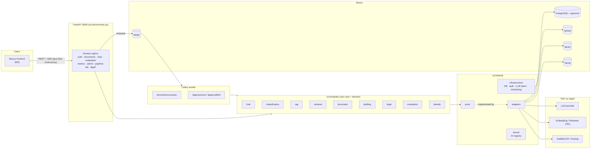
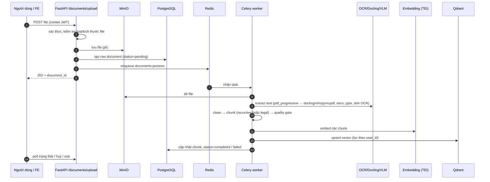
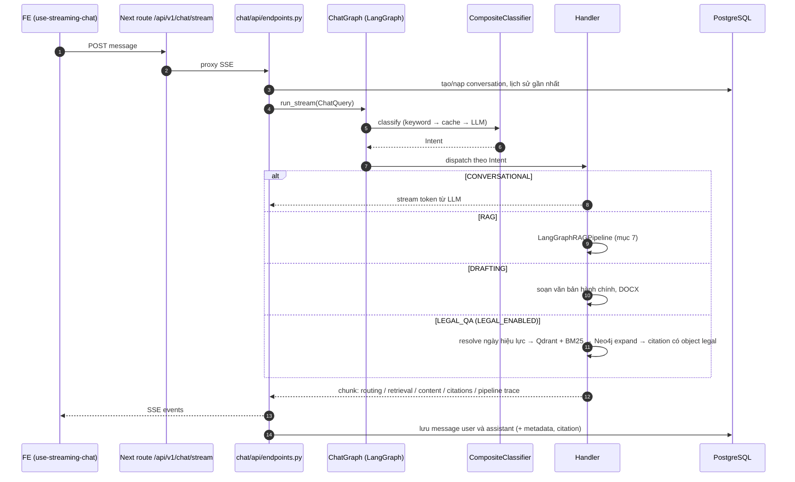
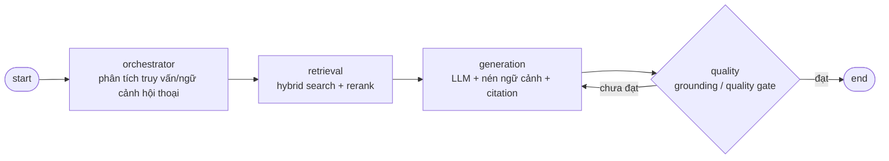
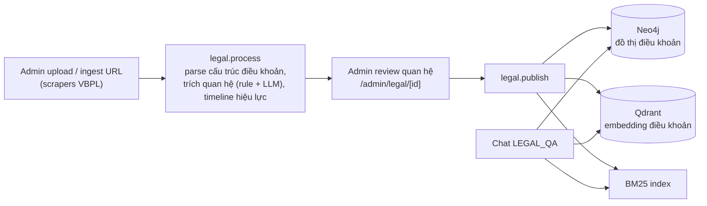

# KIRA – Kiến trúc hệ thống và luồng hoạt động

> Ngày khảo sát: 2026-11-20, nhánh `develop` (kèm thay đổi chưa commit). Số liệu lấy trực tiếp từ code, không phải từ tài liệu cũ.

## 1. Tổng quan

KIRA là ứng dụng RAG full-stack: upload tài liệu, truy xuất lai (dense + BM25 + RRF + rerank), chat có trích dẫn, đánh giá chất lượng RAG, và một nhánh **legal** (kho văn bản pháp luật Việt Nam có knowledge graph).

| Lớp | Công nghệ |
|---|---|
| Frontend | Next.js 16, React 19, TypeScript, Tailwind (cổng 3001) |
| Backend API | FastAPI, Python 3.12, SQLAlchemy asyncio (cổng 8006) |
| Worker | Celery + Redis (xử lý tài liệu, legal) |
| Lưu trữ | PostgreSQL 16 + pgvector, Qdrant (vector), MinIO (file gốc), Neo4j (đồ thị pháp lý) |
| AI ngoài | LLM (GLM/Gemini/OpenAI-compatible/Ollama), Embedding + Reranker (TEI), PaddleOCR, Docling |

## 2. Sơ đồ thành phần



(*) Router `legal` chỉ được mount khi `LEGAL_ENABLED=true`.

## 3. Phân tầng (hexagonal modular monolith)

```
src/server/ + modules/<m>/api/        HTTP: router, schema, dependency
        ↓
modules/<m>/application/              use case, DTO, orchestration
        ↓
modules/<m>/domain/                   luật nghiệp vụ, prompt, strategy
        ↓
shared/ports/                         hợp đồng (Protocol/ABC) với thế giới ngoài
        ↓
shared/adapters/ + shared/infrastructure/   Qdrant, MinIO, Neo4j, LLM, TEI, OCR, DB, JWT
```

`shared/kernel/di` (container + registry) và các file `composition.py` của từng module là nơi duy nhất lắp ráp adapter cụ thể vào use case.

### Bản đồ module

| Module | Vai trò | Thành phần chính |
|---|---|---|
| `identity` | Người dùng, đăng nhập | `application/service.py`, `user_repository.py` |
| `document` | Upload, xoá, huỷ, tải, chunk; pipeline xử lý | `application/{upload,process,delete,cancel,query}.py`, `domain/services/{extraction,chunking,cleaner,embedder,pipeline}` |
| `classification` | Phân loại ý định câu hỏi | strategies `keyword` → `cache` → `llm`, ghép bởi `composite.py` |
| `chat` | Điều phối hội thoại, SSE, lưu hội thoại | `application/{chat,graph,streaming,citations}.py`, handlers `conversational / rag / drafting` |
| `rag` | Pipeline agentic bằng LangGraph | `orchestration/{agents,graph,state}` |
| `retrieval` | Dense (Qdrant), BM25, RRF, rerank | `domain/services/{bm25,fusion,hybrid_search,reranking/*}` |
| `drafting` | Soạn văn bản hành chính, xuất DOCX | `application/docx_renderer.py` |
| `legal` | Kho pháp luật: parse cấu trúc, quan hệ, timeline, publish Neo4j/Qdrant | `domain/{parser,extraction,temporal}`, `application/publish_document.py`, `infrastructure/scrapers` |
| `evaluation` | DeepEval, golden dataset, CLI | `domain/service.py`, `runners`, `metrics`, `cli.py` |
| `debug` | "Pipeline lab" cho admin | `api.py`, `service.py` |
| `admin` | Dashboard tổng quan | `application/overview.py` |

## 4. Luồng khởi động backend

`src/server/main.py` → `create_app()`:

1. `setup_logging` (Loguru), CORS, exception handlers, mount router, health `/health`, `/health/ready`, `/health/live`.
2. `lifespan`: khởi tạo DB và schema, kiểm tra Embedding API, `init_retrieval_tools()` + `init_ingestion_tools()` (singleton toàn cục trong `src/tools`), tạo LLM client cho rerank/hybrid, khởi tạo reranker, rồi in **bảng sức khoẻ phụ thuộc** (`startup_health.py`: Postgres, Qdrant, Neo4j, MinIO, Redis, Celery, Embedding, Reranker, LLM, PaddleOCR, Docling).
3. Một service phụ thuộc chết **không chặn** startup, chỉ log `WARNING ... DOWN`. Lỗi sẽ lộ ra ở thời điểm dùng (upload, chat).

## 5. Luồng upload và xử lý tài liệu



Điểm cần nhớ:
- Upload chỉ thành công khi Redis **và** Celery worker đang chạy. Nếu worker chết, document kẹt ở `pending`.
- Hủy và xoá cũng đi qua task/hàng đợi (bảng `document_deletion_jobs`, cột cancel – xem `migrations/03,04`).
- Mọi truy vấn tài liệu phải kèm `user_id` (cô lập theo người dùng).

## 6. Luồng chat (SSE)



Hợp đồng SSE (`routing`, `retrieval`, `content`, citations, `pipeline trace`) được frontend phân tích trong `frontend/src/lib/streaming/*`. Đổi payload ở backend phải đổi cùng lúc ở `streaming-state-builder.ts` và `pipeline-trace.ts`.

## 7. Pipeline RAG agentic

`src/modules/rag/orchestration/graph/langgraph_pipeline.py`:



Hybrid search (`retrieval/domain/services/hybrid_search.py`):
1. Dense: embed truy vấn → Qdrant (lọc `user_id`).
2. Keyword: BM25 tiếng Việt, chỉ mục dựng lại khi worker thêm/xoá tài liệu.
3. Hợp nhất bằng RRF (`fusion.py`).
4. Rerank: TEI, LLM hoặc scoring (`reranking/`, chọn bằng `RERANKING_MODE`).

## 8. Luồng legal (nếu `LEGAL_ENABLED=true`)



## 9. Dữ liệu và lưu trữ

| Nơi | Chứa gì |
|---|---|
| PostgreSQL | users, documents, chunks metadata, conversations, messages, deletion jobs, bảng legal |
| Qdrant | vector chunk (1024 chiều, phải khớp embedding API) |
| MinIO | file gốc, bucket `kira-documents` |
| Neo4j | đồ thị văn bản và điều khoản pháp lý |
| Redis | broker/backend của Celery |

Schema được tạo khi khởi động từ `models.py`. Thư mục `migrations/*.sql` là script tay đánh số, chưa có công cụ migration (xem báo cáo cấu trúc).

## 10. Frontend

```
frontend/src/
  app/            routes: login, register, conversation(/[id]), conversations, uploads,
                  admin (legal, pipeline-lab), api/v1/chat/stream (proxy SSE)
  components/     ui, layout, sidebar, conversation, simple (SimpleChat), streaming (citation, trace),
                  sources (panel nguồn), legal, auth, mobile, common
  lib/            api (simple-client), hooks (use-simple-chat, use-streaming-chat),
                  stores, streaming (state builder, pipeline trace), types, utils, legal
  locales/, lib/locales/, i18n/    đa ngôn ngữ en/vi (đang bị phân tán, xem báo cáo)
```

## 11. Triển khai

- `docker-compose.yml`: infra (postgres, qdrant, minio, redis, neo4j) và profile `app` (api, worker, frontend), profile `tunnel` (cloudflared).
- `Dockerfile` gốc dùng chung cho API và worker; `frontend/Dockerfile` build Next.js standalone.
- CI (`.github/workflows`): `ci.yml` (ruff check, ruff format --check, mypy, pytest, có Redis service) và `validate-modular-monolith-architecture.yml`.
