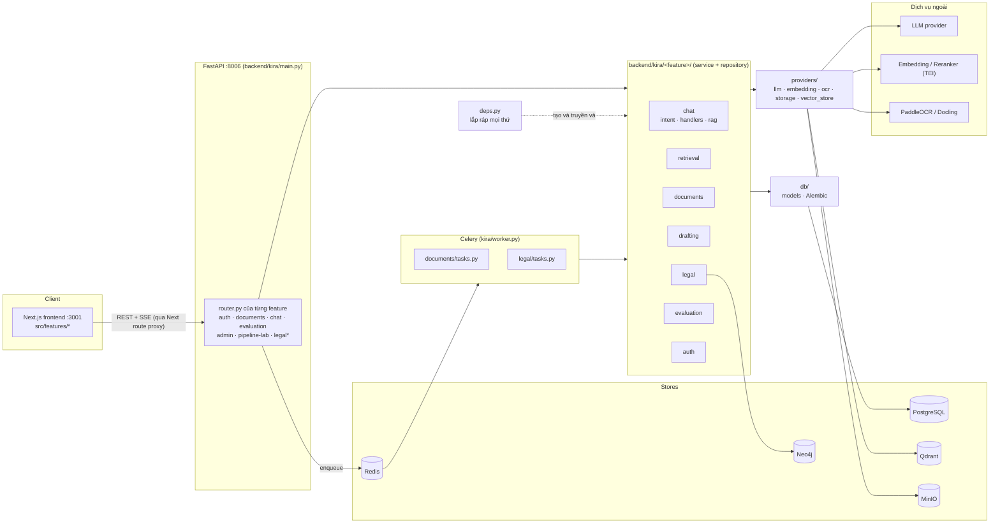
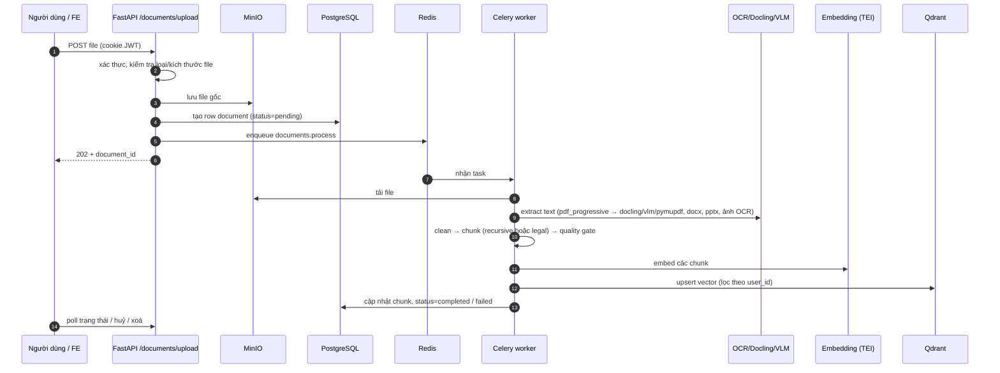
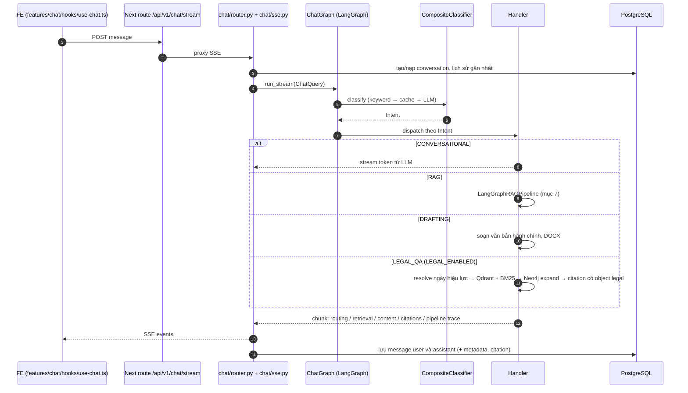
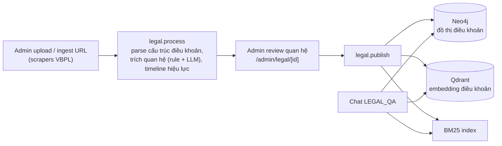

# KIRA – Kiến trúc hệ thống và luồng hoạt động

> Cập nhật 2026-11-21 theo cấu trúc mới (`backend/kira`, feature-first). Số liệu lấy trực tiếp từ code.

## 1. Tổng quan

KIRA là ứng dụng RAG full-stack: upload tài liệu, truy xuất lai (dense + BM25 + RRF + rerank), chat có trích dẫn, đánh giá chất lượng RAG, và một nhánh **legal** (kho văn bản pháp luật Việt Nam có knowledge graph).

| Lớp | Công nghệ |
|---|---|
| Frontend | Next.js 16, React 19, TypeScript, Tailwind (cổng 3001) |
| Backend API | FastAPI, Python 3.12, SQLAlchemy asyncio (cổng 8006) |
| Worker | Celery + Redis (xử lý tài liệu, legal) |
| Lưu trữ | PostgreSQL 16 + pgvector, Qdrant (vector), MinIO (file gốc), Neo4j (đồ thị pháp lý) |
| AI ngoài | LLM (GLM/Gemini/OpenAI-compatible/Ollama), Embedding + Reranker (TEI), PaddleOCR, Docling |

## 2. Sơ đồ thành phần



(*) Router `legal` chỉ được mount khi `LEGAL_ENABLED=true`.

## 3. Tổ chức code (feature-first)

```text
backend/kira/<feature>/router.py        HTTP: nhận request, gọi service, trả response
        ↓
backend/kira/<feature>/service.py       nghiệp vụ (hoặc một file cho mỗi thao tác: upload.py, delete.py...)
        ↓
backend/kira/<feature>/repository.py    toàn bộ SQL của feature
backend/kira/providers/                 LLM, embedding, OCR, MinIO, Qdrant (interface chỉ khi có nhiều cài đặt)
```

`backend/kira/deps.py` là **nơi duy nhất** tạo provider và service rồi truyền vào; service không tự tạo dependency.
Các luật này được kiểm bằng `backend/tests/unit/test_architecture.py` (xem `CLAUDE.md`).

### Bản đồ feature

| Feature | Vai trò | Thành phần chính |
|---|---|---|
| `auth` | Người dùng, đăng nhập, JWT cookie, rate limit | `router.py`, `service.py`, `repository.py`, `security.py` |
| `documents` | Upload, xoá, huỷ, tải, chunk; pipeline xử lý | `upload.py`, `process.py`, `delete.py`, `cancel.py`, `queries.py`, `repository.py`, `tasks.py`, `processing/{extraction,chunking,pipeline,...}` |
| `retrieval` | Dense (Qdrant), BM25, RRF, rerank | `search.py` (điểm vào), `bm25.py`, `hybrid_search.py`, `fusion.py`, `rerank/` |
| `chat` | Hội thoại, SSE, lưu tin nhắn, định tuyến ý định | `router.py`, `sse.py`, `messages.py`, `service.py`, `graph.py`, `intent/` (keyword → cache → LLM), `handlers/` |
| `chat/rag` | Pipeline agentic bằng LangGraph | `graph.py`, `state.py`, `nodes/{orchestrator,retrieval,generation,quality}.py`, `prompts/` |
| `drafting` | Soạn văn bản hành chính, xuất DOCX | `prompts.py`, `docx_renderer.py`, handler ở `chat/handlers/drafting.py` |
| `legal` | Kho pháp luật: parse cấu trúc, quan hệ, timeline, publish Neo4j/Qdrant | `services/`, `parser.py`, `extraction/`, `temporal/`, `graph/`, `scrapers/`, `tasks.py` |
| `evaluation` | DeepEval, golden dataset, CLI | `service.py`, `runners/`, `metrics/`, `cli.py` |
| `pipeline_lab` | Công cụ admin soi từng bước pipeline | `router.py`, `service.py` |
| `admin` | Dashboard tổng quan | `router.py`, `service.py`, `repository.py` |

## 4. Luồng khởi động backend

`backend/kira/main.py` → `create_app()`:

1. `setup_logging` (Loguru), CORS, exception handlers, mount router, health `/health`, `/health/ready`, `/health/live`.
2. `lifespan`: `init_db()` chạy **Alembic migrations** (`kira/db/migrate.py`; DB cũ chưa có lịch sử Alembic được stamp baseline `0001`), tạo LLM client cho rerank, khởi tạo reranker, rồi in **bảng sức khoẻ phụ thuộc** (`kira/core/health.py`: Postgres, Qdrant, Neo4j, MinIO, Redis, Celery, Embedding, Reranker, LLM, PaddleOCR, Docling).
3. Một service phụ thuộc chết **không chặn** startup, chỉ log `WARNING ... DOWN`. Lỗi sẽ lộ ra ở thời điểm dùng (upload, chat).

## 5. Luồng upload và xử lý tài liệu



Điểm cần nhớ:
- Upload chỉ thành công khi Redis **và** Celery worker đang chạy. Nếu worker chết, document kẹt ở `pending`.
- Hủy và xoá cũng đi qua task/hàng đợi (bảng `document_deletion_jobs`, cột cancel trong `backend/kira/db/models.py`).
- Mọi truy vấn tài liệu phải kèm `user_id` (cô lập theo người dùng).

## 6. Luồng chat (SSE)



Hợp đồng SSE (`routing`, `retrieval`, `content`, citations, `pipeline trace`) được frontend phân tích trong `frontend/src/features/chat/streaming/*`. Đổi payload ở backend phải đổi cùng lúc ở `streaming-state-builder.ts` và `pipeline-trace.ts`.

## 7. Pipeline RAG agentic

`backend/kira/chat/rag/graph.py`:


Hybrid search (`backend/kira/retrieval/hybrid_search.py`, gọi qua `retrieval/search.py`):
1. Dense: embed truy vấn → Qdrant (lọc `user_id`).
2. Keyword: BM25 tiếng Việt, chỉ mục dựng lại khi worker thêm/xoá tài liệu.
3. Hợp nhất bằng RRF (`fusion.py`).
4. Rerank: TEI, LLM hoặc scoring (`retrieval/rerank/`, chọn bằng `RERANKING_MODE`).

## 8. Luồng legal (nếu `LEGAL_ENABLED=true`)



## 9. Dữ liệu và lưu trữ

| Nơi | Chứa gì |
|---|---|
| PostgreSQL | users, documents, chunks metadata, conversations, messages, deletion jobs, bảng legal |
| Qdrant | vector chunk (1024 chiều, phải khớp embedding API) |
| MinIO | file gốc, bucket `kira-documents` |
| Neo4j | đồ thị văn bản và điều khoản pháp lý |
| Redis | broker/backend của Celery |

Schema do **Alembic** quản lý: models ở `backend/kira/db/models.py`, migration ở `backend/kira/db/migrations/versions/`. App tự chạy `upgrade head` khi khởi động; tạo migration mới bằng `make db-revision MSG="..."`.

## 10. Frontend

```text
frontend/src/
  app/                    routes: login, register, conversation(/[id]), conversations, uploads,
                          admin (legal, pipeline-lab), api/v1/chat/stream (proxy SSE)
  features/
    chat/                 components (ChatView, citation, pipeline trace), sources/ (panel nguồn),
                          hooks/use-chat.ts, streaming/ (parser SSE), stores/, api.ts
    documents/            components, hooks/use-documents-upload.ts, api.ts
    legal/                components, admin/, hooks, api.ts, format.ts, types.ts
    auth/                 AuthGuard, store.ts, api.ts
    admin/                api.ts, pipeline-lab-api.ts
  components/             dùng chung: ui/ (shadcn), layout/ (sidebar, mobile nav), common/
  lib/                    api/http.ts (fetchAPI, ApiError), backend-url, theme, utils
```

Quy ước: file component `PascalCase.tsx`, còn lại `kebab-case.ts`, import qua `@/`. Test đặt cạnh file (`X.test.tsx`).

## 11. Triển khai

- `docker-compose.yml`: infra (postgres, qdrant, minio, redis, neo4j) và profile `app` (api, worker, frontend), profile `tunnel` (cloudflared).
- `backend/Dockerfile` dùng chung cho API và worker; `frontend/Dockerfile` build Next.js standalone.
- CI (`.github/workflows/ci.yml`): backend (ruff check, ruff format --check, mypy, pytest gồm cả luật kiến trúc) và frontend (eslint, vitest, build).
