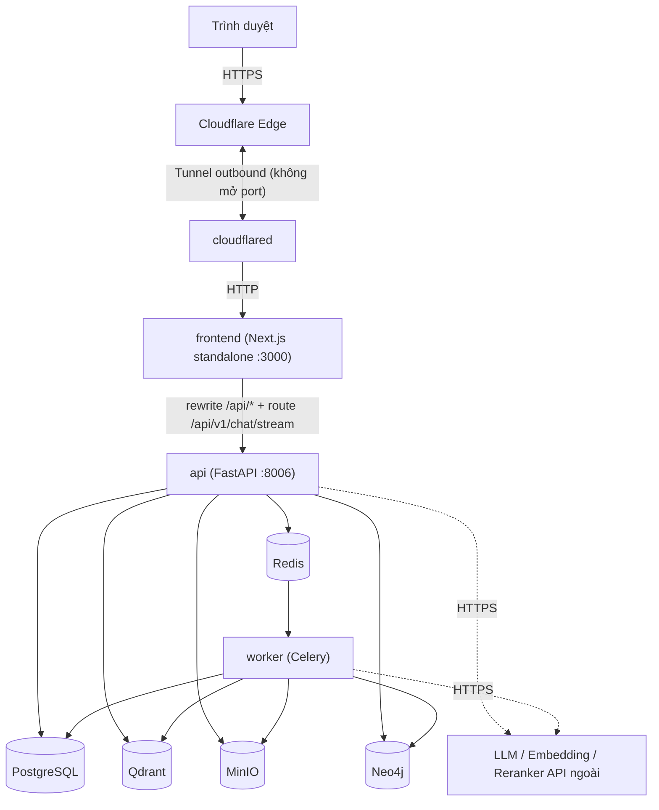

# Triển khai KIRA bằng Docker Compose + Cloudflare Tunnel

Đưa toàn bộ KIRA (Next.js, FastAPI, Celery worker, PostgreSQL/pgvector, Qdrant, MinIO, Redis, Neo4j) lên Internet
qua **Cloudflare Tunnel (`cloudflared`)**: không mở port, có HTTPS, ẩn IP máy chủ, SSE chat stream vẫn hoạt động.

## 1. Kiến trúc



Chỉ cần **một hostname** trỏ vào `frontend:3000`; mọi lời gọi `/api/*` được Next.js chuyển nội bộ sang `api:8006`,
nên cookie httpOnly là same-origin và backend không cần public.

| Service | Container | Profile | Ghi chú |
|---|---|---|---|
| postgres, qdrant, minio, redis, neo4j | `kira-simple-*` | (mặc định) | `make infra` như cũ |
| api | `kira-simple-api` | `app`, `tunnel` | image `kira-backend`, không publish port |
| worker | `kira-simple-worker` | `app`, `tunnel` | cùng image, chạy Celery |
| frontend | `kira-simple-frontend` | `app`, `tunnel` | host port `${DEPLOY_FRONTEND_PORT:-3002}` |
| cloudflared | `kira-simple-tunnel` | `tunnel` | Quick hoặc Named Tunnel |

## 2. Chuẩn bị `.env`

Compose dùng chung file `.env` ở gốc repo (`env_file`). Trong container, các biến sau **tự động bị ghi đè** sang tên
service nội bộ, không cần sửa: `POSTGRES_HOST/PORT`, `REDIS_HOST/PORT`, `CELERY_BROKER_URL`, `CELERY_RESULT_BACKEND`,
`QDRANT_HOST/PORT`, `MINIO_ENDPOINT`, `NEO4J_URI`. `DEBUG` lấy từ `DEPLOY_DEBUG` (mặc định `false` → cookie
`Secure` + `SameSite=strict`, phù hợp HTTPS).

Cần kiểm tra:

- `JWT_SECRET_KEY` đủ mạnh. Nếu đặt `APP_ENV=production`, backend từ chối secret mặc định.
- Trích xuất PDF trong container mặc định là **VLM** (`PDF_EXTRACTOR=vlm`, đổi bằng `DEPLOY_PDF_EXTRACTOR`):
  từng trang được render và gửi tới endpoint `/v1/chat/completions` OpenAI-compatible cấu hình bằng
  `OLLAMA_BASE_URL`, `OLLAMA_API_KEYS`, `OLLAMA_MODEL` (Ollama Cloud, OpenAI…). Chỉ khi VLM lỗi mới chuyển sang PyMuPDF + PaddleOCR.
- OCR fallback được gọi qua `DEPLOY_OCR_BASE_URL` (mặc định `http://host.docker.internal:8889`, tức PaddleOCR chạy
  trên host). Không có OCR thì VLM vẫn chạy bình thường; muốn bỏ hẳn fallback thì đặt `OCR_ENABLED=false`.
- Dịch vụ khác chỉ chạy trên host (embedding cục bộ…) cũng phải dùng `http://host.docker.internal:<port>`
  thay vì `localhost`.
- LLM/embedding/reranker API phải truy cập được từ trong container (nếu nằm trong mạng nội bộ cần VPN thì
  VPN phải đang bật trên host).

## 3. Phương thức 1: Quick Tunnel (miễn phí, không cần domain/tài khoản)

```bash
make deploy-tunnel      # build image + chạy full stack + cloudflared
make tunnel-url         # in ra https://xxxx.trycloudflare.com
```

URL đổi mỗi lần container `cloudflared` khởi động lại. Chỉ nên dùng để demo/thử nghiệm.

## 4. Phương thức 2: Named Tunnel (domain riêng)

1. Cloudflare Dashboard → **Zero Trust** → **Networks → Tunnels** → **Create a tunnel** → loại *Cloudflared*,
   đặt tên (vd. `kira-prod`) → bước *Install connector* chọn **Docker**, chép token sau `--token`.
2. Tab **Public Hostname** → *Add a public hostname*:
   - Subdomain/Domain: vd. `kira.yourdomain.com`
   - Service: **HTTP** → `frontend:3000` (cloudflared chạy chung mạng Docker với frontend)
3. Trong `.env`:
   ```bash
   CLOUDFLARE_TUNNEL_TOKEN=eyJh...
   CLOUDFLARE_TUNNEL_CMD="tunnel --no-autoupdate run"
   ```
4. Chạy `make deploy-tunnel`, rồi kiểm tra `docker logs -f kira-simple-tunnel` thấy
   `Registered tunnel connection` là thành công.

Upload file: Cloudflare Free/Pro giới hạn **100 MB/request**, khớp với `proxyClientMaxBodySize: '100mb'` của Next.js.

## 5. Vận hành

```bash
make deploy          # chỉ chạy full stack trong Docker, truy cập http://localhost:3002 (không tunnel)
make deploy-logs     # theo dõi log api/worker/frontend/cloudflared
make deploy-stop     # dừng app + tunnel, giữ nguyên hạ tầng & dữ liệu
docker compose --profile tunnel up -d --build api worker   # rebuild backend sau khi đổi code
```

Lưu ý tài nguyên: build image và chạy thêm api/worker/frontend chiếm RAM đáng kể. Dừng `make dev`
(backend :8006, next dev :3001) trước khi deploy nếu máy đang thiếu bộ nhớ.

## 6. Bảo mật

- Quick Tunnel là URL công khai: ai có link đều mở được trang đăng nhập. Giữ `AUTH_ENABLED=true`.
- Có thể thêm **Cloudflare Access** (Zero Trust → Access → Applications) cho hostname của Named Tunnel để chặn
  người ngoài trước khi tới app.
- Các port hạ tầng (5433, 6333, 9000, 6379, 7687) vẫn publish ra host cho môi trường dev; trên VPS nên
  firewall chặn chúng hoặc bỏ mục `ports` của các service này.
