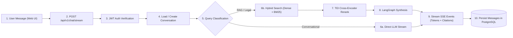

# Project Overview

## Summary

KIRA is a full-stack Retrieval-Augmented Generation application for Vietnamese-first document workflows. Users can register, upload documents, wait for background ingestion, and ask questions that are answered with retrieved context and citations.

The repository is organized as a hexagonal modular monolith on the backend and a Next.js App Router frontend.

## Core Capabilities

- Multi-user authentication with JWT and httpOnly cookies
- Document upload, download, deletion, chunk inspection, and processing status
- Background document ingestion through Celery and Redis
- File storage in MinIO and metadata storage in PostgreSQL
- Dense retrieval through Qdrant
- Keyword retrieval through BM25
- Hybrid search through Reciprocal Rank Fusion
- Optional LLM reranking and citation verification behavior
- Streaming chat over Server-Sent Events
- Conversation persistence with soft delete
- DeepEval-based RAG evaluation APIs and CLI helpers

## Tech Stack

| Area | Stack |
| --- | --- |
| Backend runtime | Python 3.12, FastAPI, Pydantic Settings |
| Backend data | SQLAlchemy asyncio, PostgreSQL 16 + pgvector |
| Retrieval | Qdrant, BM25, RRF fusion |
| Background jobs | Celery, Redis |
| File storage | MinIO |
| Frontend | Next.js 16, React 19, TypeScript, Tailwind CSS |
| UI/state | Radix UI/shadcn-style components, Zustand, TanStack Query |
| AI services | GLM/Z.ai default, Gemini/OpenAI-compatible/Ollama options, external embedding API |
| Quality | Pytest, Ruff, MyPy, ESLint, Vitest, DeepEval |

## Backend Architecture

```text
src/
├── server/                   # FastAPI app setup, middleware, server-owned API routes
├── modules/                  # Application modules
│   ├── chat/                 # Chat orchestration, streaming, persistence
│   ├── classification/       # Query intent routing
│   ├── document/             # Upload, processing, storage workflow
│   ├── evaluation/           # DeepEval services and dataset management
│   ├── rag/                  # Agentic/LangGraph RAG orchestration
│   └── retrieval/            # Dense, BM25, hybrid search, reranking
├── shared/                   # Ports, adapters, infrastructure, kernel, shared domain
├── config/                   # Runtime and static configuration
├── tools/                    # Retrieval and ingestion initialization
└── worker/                   # Celery app and document tasks
```

The dependency direction should stay inward:

```text
HTTP/API -> application use cases -> domain rules -> shared ports -> adapters/infrastructure
```

## Runtime Services

Local Docker Compose starts:

- PostgreSQL on host port `5433`
- Qdrant on host port `6333`
- MinIO on host ports `9000` and `9001`
- Redis on host port `6379`

Development servers:

- Backend: http://localhost:8006
- Frontend: http://localhost:3001
- API docs: http://localhost:8006/docs

## Main Request Flows

### Chat Flow



### Document Upload Flow

```mermaid
---
config:
  theme: default
---
flowchart LR
    Upload["1. File Upload (PDF/DOCX)"] --> DocAPI["2. POST /api/v1/documents/upload"]
    DocAPI --> MinIO[("3. Store in MinIO S3")]
    MinIO --> PGRecord[("4. Insert 'pending' in PostgreSQL")]
    PGRecord --> Enqueue["5. Enqueue Celery Task (Redis)"]
    
    Enqueue --> Worker["6. Celery Worker (Docling/PyMuPDF)"]
    Worker --> ChunkClean["7. Cleaning & Legal Chunking"]
    ChunkClean --> Embed["8. TEI BGE-M3 (1024-dim)"]
    Embed --> Index[("9. Upsert Qdrant & Update BM25")]
    Index --> Complete[("10. Update 'completed' in PostgreSQL")]
```



## Important Configuration

Runtime settings are defined in `src/config/config.py`; static defaults are defined in `src/config/settings.yaml`.

High-impact values:

- `JWT_SECRET_KEY`
- `POSTGRES_*`
- `QDRANT_*`
- `MINIO_*`
- `REDIS_*` and `CELERY_*`
- `LLM_PROVIDER` and provider API keys
- `EMBEDDING_BASE_URL`, `EMBEDDING_MODEL`, `EMBEDDING_DIM`
- `qdrant.vector_dim` in `settings.yaml`

The embedding dimension and Qdrant vector dimension must match. The default is `1024`.

## Documentation Map

- `README.md`: product-facing overview, setup, API summary, image guidance
- `CLAUDE.md`: AI/developer operating guide
- `docs/system-architecture.md`: architecture diagrams and module breakdown
- `docs/deployment-guide.md`: local and production deployment notes
- `docs/high-accuracy-document-processing-pipeline.md`: document extraction pipeline details
- `docs/docling-document-processing.md`: Docling-specific document processing notes
- `docs/code-standards.md`: coding conventions and structure guidance
- `docs/project-roadmap.md`: roadmap and priorities
