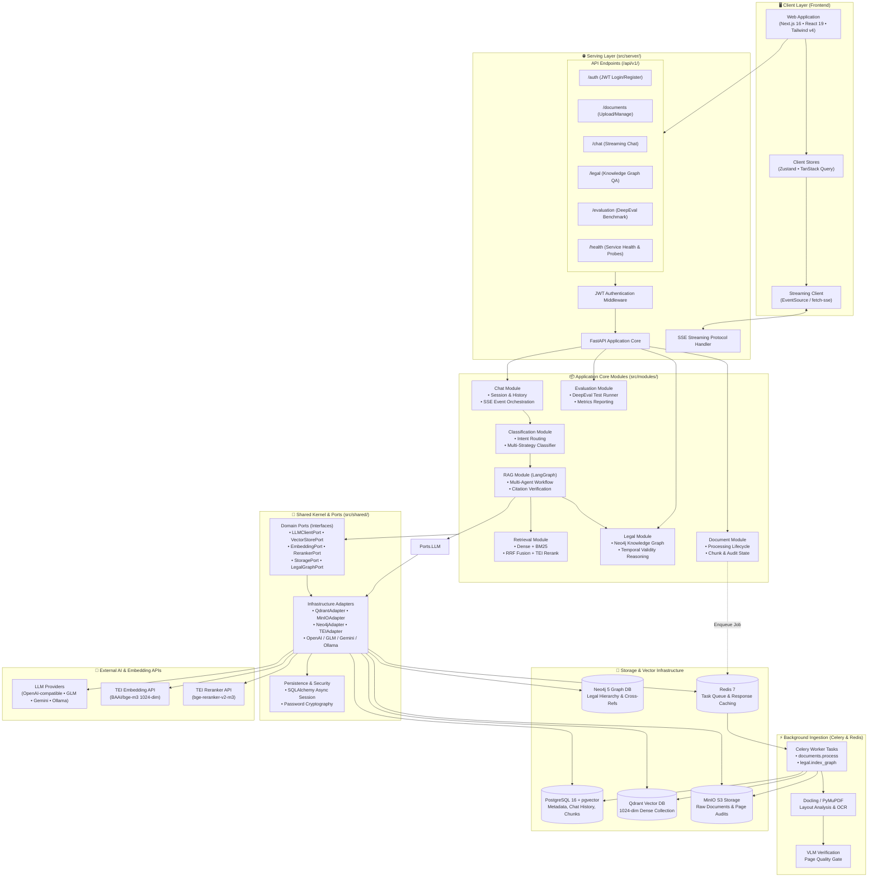
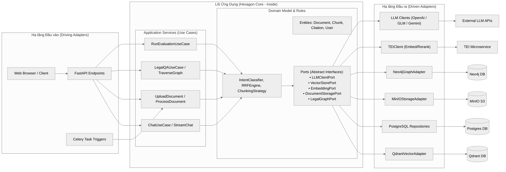
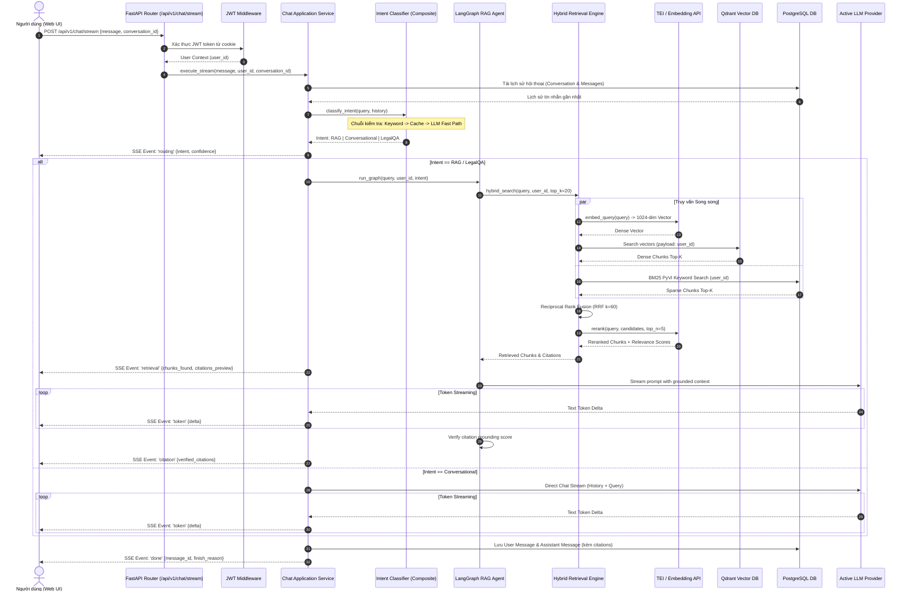
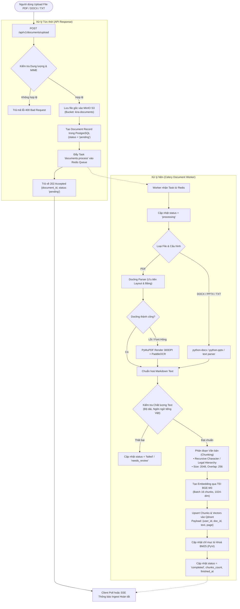
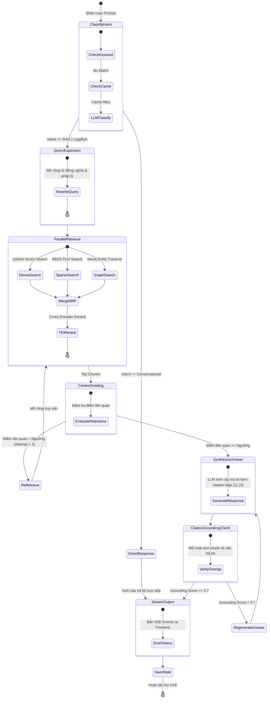
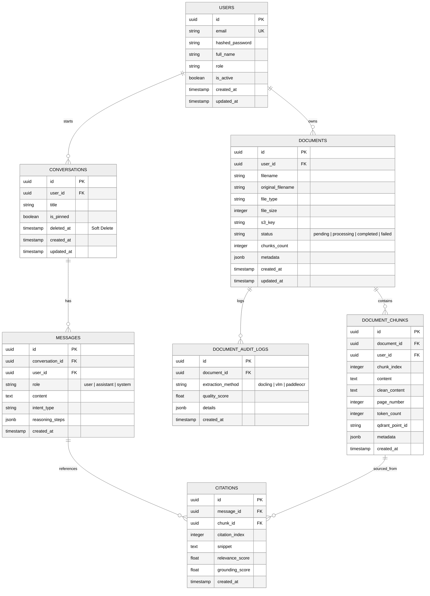
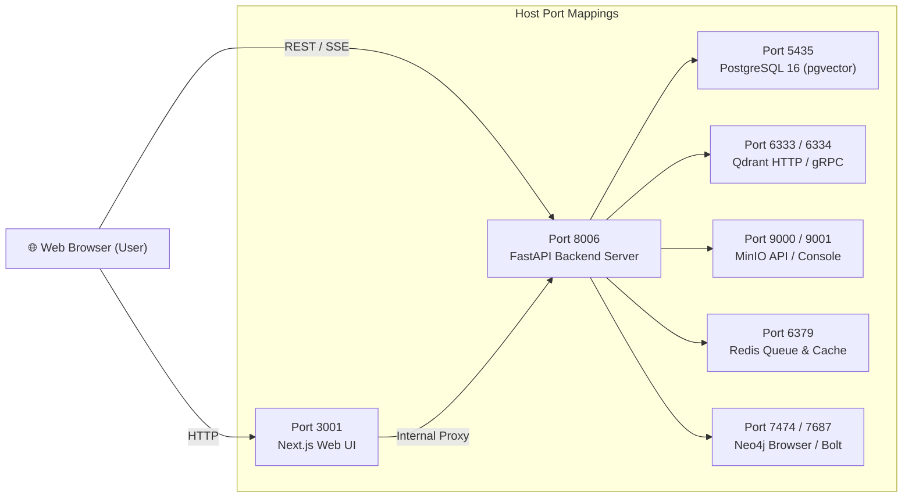

# Kiến trúc Hệ thống (System Architecture)

Tài liệu này cung cấp thiết kế kiến trúc toàn diện của **KIRA (Knowledge-based Intelligent Retrieval Assistant)** — nền tảng RAG hiệu năng cao tối ưu cho tiếng Việt, được xây dựng theo mô hình **Hexagonal Modular Monolith** ở backend và **Next.js 16 App Router** ở frontend.

---

## 1. Tổng quan Kiến trúc Toàn hệ thống (System Overview)

Hệ thống tuân thủ nghiêm ngặt nguyên tắc phụ thuộc hướng tâm của Hexagonal Architecture (Ports & Adapters), chia tách rõ ràng các tầng trách nhiệm:



---

## 2. Mô hình Hexagonal Architecture (Ports & Adapters)

KIRA áp dụng nguyên lý cô lập hoàn toàn nghiệp vụ cốt lõi (**Inside**) khỏi chi tiết hạ tầng kỹ thuật (**Outside**):



### Quy tắc Phụ thuộc Bắt buộc (Dependency Rule):
1. **Mã nguồn tầng `application/` và `domain/`** chỉ được phụ thuộc vào `Ports` (Interfaces trừu tượng), không bao giờ import trực tiếp các `Adapters` cụ thể từ `infrastructure/`.
2. **Không có Business Logic trong FastAPI Router**: Router chỉ kiểm tra HTTP DTO, ủy quyền xử lý cho Application Service, và trả về Response/SSE Stream.
3. **Mọi câu truy vấn dữ liệu** (PostgreSQL, Qdrant, MinIO) đều bắt buộc lọc theo `user_id` để đảm bảo an toàn đa người dùng (Multi-Tenancy).

---

## 3. Luồng Xử lý Dữ liệu Chi tiết (Data Flows)

### 3.1 Luồng Hội thoại Thời gian thực (Real-time SSE Streaming Chat)



---

### 3.2 Luồng Nhập liệu Tài liệu Bất đồng bộ (Asynchronous Document Ingestion)



---

### 3.3 Máy Trạng thái RAG LangGraph (LangGraph State Machine)



---

## 4. Mô hình Thực thể Dữ liệu (Entity Relationship Diagram)

Sơ đồ quan hệ cơ sở dữ liệu lưu trữ quan hệ trong PostgreSQL 16:



---

## 5. Cấu trúc Module & Giới hạn Trách nhiệm (Modular Monolith Boundaries)

Hệ thống được tổ chức dạng thư mục rõ ràng theo cấu trúc phân tầng Hexagonal:

```text
src/
├── server/                           # Serving Layer - Điểm giao tiếp HTTP duy nhất
│   ├── main.py                      # Khởi tạo FastAPI, Lifespan và Global Handlers
│   ├── middleware/                  # JWT auth, CORS, logging context
│   └── api/v1/                      # Định nghĩa Router endpoints
│       ├── auth/                    # Đăng nhập, đăng ký, refresh token
│       ├── chat/                    # SSE streaming chat và quản lý hội thoại
│       ├── documents/               # Upload, quản lý và inspect chunks tài liệu
│       ├── legal/                   # Truy vấn đồ thị kiến thức pháp luật Neo4j
│       └── evaluation/              # Chạy benchmark đánh giá RAG DeepEval
│
├── modules/                          # Application Core Modules - Nghiệp vụ thuần tuý
│   ├── chat/                        # Quản lý phiên chat, định dạng SSE stream
│   ├── classification/              # Chiến lược phân loại ý định (Keyword, LLM, LRU Cache)
│   ├── document/                    # Upload pipeline, logic chunking và kiểm soát status
│   ├── drafting/                    # Tác vụ tự động soạn thảo văn bản
│   ├── evaluation/                  # Bộ service DeepEval, tính metric Faithfulness/Recall
│   ├── identity/ & auth/            # Quản lý thực thể User, mật khẩu, JWT credentials
│   ├── legal/                       # Xử lý đồ thị pháp lý, quan hệ văn bản, hiệu lực thời gian
│   ├── rag/                         # Multi-agent LangGraph workflow, context grading
│   └── retrieval/                   # Dense vector, BM25 tiếng Việt, RRF, Cross-encoder Reranker
│
├── shared/                           # Shared Kernel - Thành phần dùng chung toàn hệ thống
│   ├── ports/                       # Interfaces trừu tượng (LLM, VectorStore, Embedding, Storage...)
│   ├── adapters/                    # Concrete Adapters (Qdrant, MinIO, Neo4j, TEI, GLM, Gemini...)
│   ├── infrastructure/              # Hạ tầng kỹ thuật (Database connection pool, Auth, Celery)
│   ├── domain/                      # Shared entities, Value Objects và Exceptions
│   └── kernel/                      # Dependency Injection container và Service Registry
│
├── config/                           # Cấu hình hệ thống
│   ├── config.py                    # Pydantic Settings đọc từ file .env
│   └── settings.yaml                # Cấu hình tĩnh (retrieval k, chunk sizes, thresholds)
│
└── worker/                           # Celery background workers
    ├── celery_app.py                # Khởi tạo Celery Application
    ├── document_tasks.py            # Background task xử lý file và sinh vector
    └── legal_tasks.py               # Background task phân tích đồ thị quan hệ pháp luật
```

---

## 6. Chiến lược Cô lập Đa Người dùng (Multi-Tenancy Isolation)

Để ngăn ngừa triệt để rủi ro rò rỉ dữ liệu chéo người dùng:

1. **Vector Store (Qdrant)**:
   - Mọi vector khi nạp vào collection đều đính kèm trường `user_id` trong payload.
   - Khi truy vấn `client.search()`, hệ thống luôn luôn inject filter bắt buộc:
     ```python
     Filter(must=[FieldCondition(key="user_id", match=MatchValue(value=current_user_id))])
     ```
2. **Từ khoá (BM25 Sparse Index)**:
   - Mỗi người dùng sở hữu không gian chỉ mục BM25 độc lập theo `user_id`.
3. **Cơ sở dữ liệu Quan hệ (PostgreSQL)**:
   - Các bảng `DOCUMENTS`, `DOCUMENT_CHUNKS`, `CONVERSATIONS`, `MESSAGES` đều có foreign key `user_id`.
   - Các Repository luôn áp đặt điều kiện `WHERE user_id = :user_id` trong tất cả các câu lệnh `SELECT`, `UPDATE`, `DELETE`.
4. **Đối tượng Lưu trữ (MinIO S3)**:
   - Khóa lưu trữ đối tượng phân cấp theo `documents/{user_id}/{document_id}/{filename}`.

---

## 7. Môi trường Thực thi & Cấu hình Cổng (Network Topology)



---

*Tài liệu kiến trúc KIRA được cập nhật và kiểm thử đồng bộ với Mermaid.js v11 standards.*
